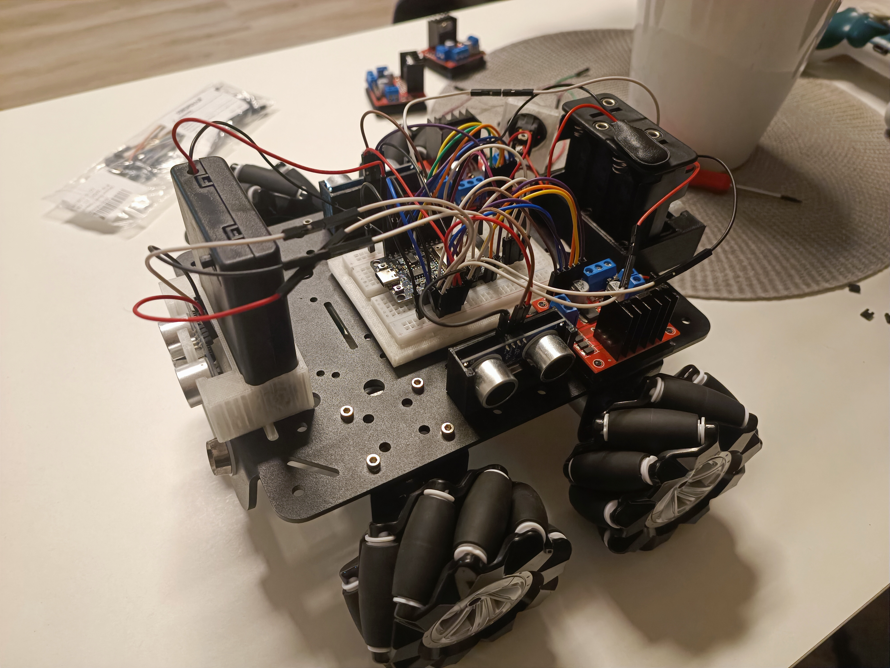

# Vývoj software a oprava robotického autíčka.
Tento repozitář slouží jako přehlídka a archiv mé, zatím budoucí, maturitní práce a obhajoby.

Součástí tohoto repa je také původní maturitní práce, dokument je ale z důvodů soukromí skryt.

Původní maturitní práce se týkala hlavně tvorby auta z hlediska hardware a robotiky.

Má maturitní práce to má brát spíše z hlediska vývoje software. Ale také opravy a vylepšení.

## O autíčku
Autíčko vzniklo jako maturitní práce *Robotické auto* jiného studenta naší školy z roku 2023. Jezdí na čtyřech DC motorech s mecanum koly, takže umí jezdit dopředu, dozadu, do stran i šikmo a otáčet se na místě. Původně se ovládalo přes Bluetooth pomocí mobilní aplikace Dabble a mělo na každé straně ultrazvukový senzor, který auto zastavil před překážkou.
 
V původní práci jsou kola popsaná jako omni, ve skutečnosti jde ale o mecanum kola. Pro software je to důležité, protože se jinak počítá, jak rychle a kterým směrem se má každé kolo točit.
 
## Co se změnilo
- **Nová řídicí deska.** Původní ESP-WROOM-32 deska (38 pinů, micro USB) nefunguje, odešla po zkratu. Nahradila ji nová ESP32 DevKit V1 z Číny (30 pinů, USB-C, převodník CH340).
- **Nové zapojení pinů.** Piny jsou rozmístěné podle toho, kde je daná součástka na autě. Přední věci jsou vpředu desky, zadní vzadu, pravé vpravo a levé vlevo.
- **Opravený pravý senzor.** Původně měl TRIG na pinu 39, který je na ESP32 jen vstupní, takže senzor nikdy nemohl fungovat.
- **Regulace rychlosti.** Každý motor má teď navíc EN pin s PWM, takže půjde řídit rychlost. Původně jely motory buď naplno, nebo vůbec.
- **Jen dva drivery.** Levé motory jsou na levém L298N, pravé na pravém.

## Hardware

| Součástka | Počet | Poznámka |
|---|---|---|
| ESP32 DevKit V1 (30 pinů, USB-C) | 1 | náhrada za původní desku |
| Driver L298N (HW-095) | 2 | levá a pravá strana |
| DC motor s mecanum kolem | 4 | |
| Ultrazvukový senzor HC-SR04 | 4 | vpředu, vzadu, vlevo, vpravo |
| Držák 8× AA s vypínačem | 1 | napájení motorů (12 V) |
| Držák 4× AA | 1 | napájení ESP32 (6 V) |
 
## Zapojení
Deska leží v autě součástkami nahoru a USB-C míří dopředu. Řada pinů VIN … EN je tedy pravá strana auta a řada 3V3 … D23 levá. Popisky pinů odpovídají tomu, co je napsané na desce (D13 = GPIO 13, VP = GPIO 36, VN = GPIO 39).
 
### Motory

| Motor | Driver | Svorky | Směr | Rychlost |
|---|---|---|---|---|
| Přední levý | levý | OUT3 / OUT4 | IN3 ← D4, IN4 ← D16 | ENB ← D17 |
| Zadní levý | levý | OUT1 / OUT2 | IN1 ← D21, IN2 ← D22 | ENA ← D23 |
| Přední pravý | pravý | OUT3 / OUT4 | IN3 ← D13, IN4 ← D14 | ENB ← D12 |
| Zadní pravý | pravý | OUT1 / OUT2 | IN1 ← D26, IN2 ← D25 | ENA ← D33 |
 
### Senzory

| Senzor | TRIG | ECHO |
|---|---|---|
| Přední | D15 | D2 |
| Pravý | D27 | D35 |
| Zadní | D32 | VN |
| Levý | D5 | D18 |
 
VCC senzorů je napájené z +5V svorky levého driveru.
 
**Momentálně nejsou ECHO piny zapojené.** Senzor posílá na ECHO 5 V, ale ESP32 snese jen 3,3 V, takže je potřeba mezi ně dát dělič napětí (1 kΩ + 2 kΩ). Rezistory zatím nemám, takže senzory zatím nefungují a ECHO dráty vedou do breadboardu, kde zatím nikam nepokračují.
 
### Napájení
- 8× AA (+) → vypínač → +12V na obou driverech
- 8× AA (−) → GND na obou driverech
- 4× AA (+) → VIN na ESP32, (−) → GND na ESP32
- GND ESP32 je propojená s GND driverů (společná zem)

Při nahrávání přes USB je potřeba vyndat baterky z držáku 4× AA, aby se USB a baterky nepraly o napájení.
 
## Plány
Teď máme jen hardware a testovací `.ino` soubory. Dál budeme vyvíjet:
- **Aplikaci jako controller.** Možná webovou, možná pro Android. Má nahradit původní aplikaci Dabble.
- **Práci se senzory.** Hlídání překážek a zobrazení vzdáleností v aplikaci.
- **Mapu.** Možná zkusíme z dat senzorů udělat mapu okolí nebo něco podobného.

Z hardware se ještě plánuje:
- děliče napětí na ECHO, aby fungovaly senzory,
- kondenzátor k ESP32 proti restartům při rozjezdu motorů,
- možná výměna AA baterek za Li-ion 3S, protože AA motory moc neutáhnou.

## 3D modely
Vlastní modely držáků jsou ve složce [`modely/`](modely/) (`middlepart.stl`, `sw-holder-mk2.stl`, `uss-6V-holder.stl`). Modely původního auta zůstávají beze změny v `roboticke_auto/modely/`.

## Struktura repa

| Soubor | Co to je |
|---|---|
| `test_motoru.ino` | test motorů jeden po druhém přes Serial Monitor |
| `images/` | fotky autíčka |
| `modely/` | moje 3D modely (STL) |
| `roboticke_auto/` | podklady původního auta, beze změn |
 
## Poznámka k AI
Všechny dosavadní `.ino` soubory v tomto repu jsou vygenerované pomocí AI a slouží pouze jako test funkčnosti hardware. Nejsou to finální software autíčka.
